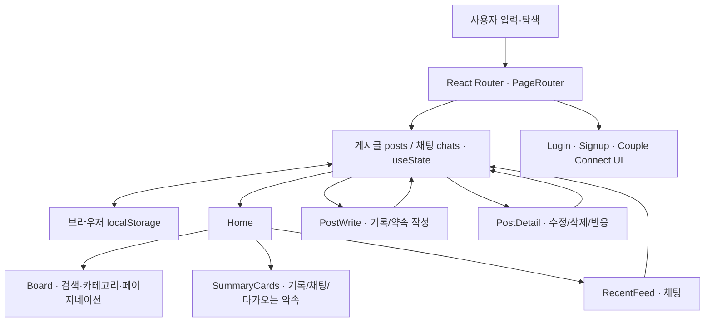

# CoupleLog — 커플 기록 React 웹서비스

> **둘만의 추억과 감정, 약속을 기록하고 다시 찾아보는 커플 기록 웹서비스**
>
> 일반 게시판을 커플 사용자의 기록·감정·약속을 관리하는 서비스로 재설계하고, **화면 설계 → 화면 이동 → 기록 작성·조회·수정·삭제 → 검색·필터 → 화면 상태 관리 → 반응형 화면 → GitHub Pages 배포**까지 React로 구현한 개인 프론트엔드 프로젝트입니다.

**2026.08 · 개인 프로젝트 · 서비스 기획 / UI·UX 설계 / React 프론트엔드 구현**

**🌐 [CoupleLog 배포 서비스 체험하기](https://hamhj7694.github.io/React_Assignment/)** · **[📖 상세 Notion 포트폴리오](https://app.notion.com/p/400c753ff28a812ea1aeebd63f015ad3)**

> **현재 구현 범위:** React 기반 프론트엔드 프로토타입으로, 게시글·반응·채팅은 브라우저 `localStorage`에서 관리합니다. 로그인·회원가입·커플 코드 화면은 UI 흐름이며, 서버 인증·DB·사용자 간 실시간 동기화는 후속 확장 항목입니다.

---

## 01. 프로젝트 한눈에 보기

| 구분 | 설계·구현 내용 |
|---|---|
| 서비스 목적 | 둘만의 추억·감정·약속을 모으고 다시 찾아볼 수 있는 기록 공간 |
| 서비스 구조 | React Router 기반 단일 페이지 앱(SPA) · 홈/작성/상세/시연용 진입 화면 |
| 데이터 상호작용 | 게시글 작성·조회·수정·삭제, 통합 검색, 카테고리 필터, **8개씩 나눠 보기** |
| 기록 유형 | 데이트 · 일상 · 마음 · 여행 · 약속 |
| 사용자 반응 | 쓴 기분, 읽은 반응, 한마디, 채팅 작성·수정·삭제 |
| 사용자 맞춤 정보 | D-Day, 오늘의 기분, 기록·채팅 요약, 가장 가까운 약속 |
| 입력·이미지 UI | 약속 전용 조건부 폼, 입력값 검증, 다중 이미지 미리보기·제거·확대 |
| 상태·저장 | `useState` / `useEffect` / 브라우저 `localStorage` |
| 배포 구성 | Vite 빌드 → GitHub Actions → GitHub Pages |

### 실제 화면 체험

서비스 화면은 **[GitHub Pages 배포 링크](https://hamhj7694.github.io/React_Assignment/)**에서 확인할 수 있습니다. 저장소에는 현재 UI의 검증된 포트폴리오 스크린샷이 별도로 없어, 오래된 이미지를 현재 화면처럼 표시하지 않았습니다.

---

## 02. 문제 정의 → UX 설계

**목표 사용자:** 서로의 추억·감정·일정을 기록하고, 쌓인 이야기를 다시 찾아보고 싶은 커플

범용 게시판에서는 조회수·좋아요·일반 카테고리가 중심이지만, 커플 기록 서비스에서는 **둘이 남긴 경험과 반응**이 더 중요하다고 보았습니다.

| 사용자 문제 | UI·기능 설계 방향 | 실제 프론트엔드 구현 |
|---|---|---|
| 공개 게시판의 진입 맥락이 맞지 않음 | 우리 둘만의 공간이라는 인식 | 로그인·회원가입·커플 연결 **시연용 화면(실제 서버 인증 미구현)** |
| 조회수·좋아요만으로는 감정이 전달되지 않음 | 관계·감정 중심의 정보 노출 | **쓴 기분·읽은 반응·한마디** 표시 |
| 기록이 쌓이면 다시 찾기 어려움 | 통합 검색 및 탐색 경로 제공 | 검색·카테고리 필터·페이지 단위 목록 보기 |
| 일상 글과 데이트 약속의 필수 정보가 다름 | 기록 유형에 따라 입력 폼 분리 | **약속 선택 시 날짜·시간·장소·메모 폼** |
| 홈에서 최근 기록과 일정을 요약하기 어려움 | 재방문 시 한눈에 상황 파악 | 기록·채팅 요약 카드와 가까운 약속 정렬 |
| 작은 화면에서 정보가 복잡해짐 | 화면 폭과 입력 수단에 맞게 재배치 | 데스크톱·태블릿·모바일 반응형 화면 |

이 프로젝트의 핵심은 디자인 목업 제작만이 아니라 **사용자 요구를 페이지·컴포넌트·상태 변화·입력 검증으로 연결한 것**입니다.

---

## 03. 핵심 사용자 기능

### 3-1. 기록 생성·조회·수정·삭제

- **기록 작성:** 제목·카테고리·기분·본문·사진 입력
- **게시글 목록:** 카테고리별 배지·쓴 기분과 기록 내용 표시
- **상세 조회:** 기록별 사진과 읽은 반응·한마디 확인
- **수정·삭제:** 작성 내용을 수정하거나 확인 후 삭제
- **입력 검증:** 일반 글의 제목·본문, 약속 글의 제목·날짜·시간 필수 검사

관련 코드: [기록 작성](src/page/PostWrite.jsx) · [상세·수정·삭제](src/page/PostDetail.jsx) · [기록 목록](src/components/Board.jsx)

### 3-2. 검색·필터·페이지 단위 목록 보기

- 제목 · 본문 · 작성자 · 카테고리 · 기분을 대상으로 **통합 검색**
- 검색어와 카테고리 필터를 **동시에 적용**
- 검색 조건이 바뀌면 페이지를 초기화하고 **한 페이지 8개** 노출
- 작성된 기록이 없거나 검색 결과가 없을 때 **상황에 맞는 빈 화면 안내** 표시

관련 코드: [Board](src/components/Board.jsx) · [Category](src/components/Category.jsx) · [Home](src/page/Home.jsx)

### 3-3. 약속 유형에 따라 달라지는 입력 화면

**일반 기록**
- 제목 / 카테고리 / 기분 / 본문 / 사진

**약속 기록**
- 약속 제목 / 날짜 / 시간 / 장소 / 메모 / 사진

`약속` 카테고리를 선택하면 전용 입력 화면으로 변경되며, 다른 카테고리로 전환하면 관련 입력 상태를 초기화합니다. 저장된 약속 데이터는 **홈의 다가오는 약속 카드**에서도 재사용합니다.

관련 코드: [기록 작성](src/page/PostWrite.jsx) · [약속 요약](src/components/SummaryCards.jsx)

### 3-4. 반응·채팅·개인화 UI

| 영역 | 구현 내용 |
|---|---|
| 읽은 반응 · 한마디 | 반응 이모지·한마디 등록 및 기록별 반응 상태 갱신 |
| 채팅 | 메시지 작성·수정·삭제, 새 메시지 추가 시 하단 스크롤 |
| D-Day | 시작 날짜 입력·변경과 경과일 표시 |
| 오늘의 기분 | 기분 선택과 날짜 기준 상태 보존 |
| 오늘의 멘트 | 제안 문구·수정 및 현재 브라우저 저장 |
| 홈 요약 | 전체 기록·내 기록·채팅 수·가까운 약속 |

채팅과 두 사람의 반응은 **동일 브라우저에서 시연하는 UI 상태**이며, 실제 두 사용자 간 메시지 전달·서버 동기화가 아닙니다.

관련 코드: [반응](src/components/PostReaction.jsx) · [채팅](src/components/RecentFeed.jsx) · [D-Day·기분](src/components/Top.jsx) · [오늘의 멘트·메뉴](src/components/Menu.jsx)

### 3-5. 이미지 선택·미리보기

- 여러 이미지 선택, 썸네일 미리보기 및 제거
- 클릭 시 이미지 확대 뷰어
- **현재 구현 한계:** 이미지 URL을 `URL.createObjectURL(file)`로 생성하므로 현재 브라우저 세션의 **임시 미리보기**에 해당합니다. 게시글 객체에 URL 문자열을 저장하더라도 새로고침·재접속 이후 원본 이미지가 영구 복원되는 구조가 아닙니다.
- 향후 파일을 지속 보존하려면 서버 파일 저장소, IndexedDB 등 별도 저장·복구 구조가 필요합니다.

관련 코드: [이미지 입력 컴포넌트](src/components/PostWrite/PostWriteImage.jsx) · [이미지 뷰어](src/components/ImageViewer.jsx)

---

## 04. React SPA 아키텍처와 상태 흐름



### 설계 포인트

1. **페이지 역할 분리:** PageRouter에서 Home, PostWrite, PostDetail 및 서비스 진입 화면의 라우팅을 정의
2. **공통 상태 관리:** `posts`와 `chats`는 PageRouter에서 관리하고 필요한 페이지·컴포넌트로 전달
3. **상태 변화의 재사용:** 게시글 추가·수정·삭제 시 동일한 `posts` 상태를 이용하는 Board·Category·SummaryCards가 함께 갱신
4. **브라우저 저장:** `useEffect`가 posts/chats 변경을 감지해 `localStorage`에 직렬화하고 새로고침 시 읽어옴
5. **UI 분리:** 기록 작성, 약속 폼, 이미지 뷰어, 채팅, 반응, 카드 등을 개별 컴포넌트로 분리

**상태 흐름 예시**

```text
기록 작성 → 입력 검증 → posts 상태 갱신 → localStorage 저장
                         ↓
             Board · Category · SummaryCards 반영

약속 작성 → schedule 데이터 포함 저장
                         ↓
              다가오는 약속 카드에서 재사용

반응 등록 → 해당 post.reactions 업데이트 → 상세 화면에 반영
```

**실제 라우트:** `/home`, `/write`, `/post/:id`, `/signup`, `/couple-connect`, `/create-code`, `/join-code`. 루트 `/`는 `/home`으로 이동합니다. 갤러리·캘린더·설정 등의 독립 라우트는 현재 구현된 서비스 기능에 포함하지 않습니다.

참고 코드: [PageRouter](src/Router/PageRouter.jsx) · [Home](src/page/Home.jsx)

---

## 05. UI·반응형 설계

- **Desktop:** 기록 목록·요약·사이드 콘텐츠를 함께 볼 수 있는 레이아웃
- **Tablet / Mobile:** 좁은 화면에서 콘텐츠 영역을 재배치하고 메뉴·여백 조절
- **Navigation:** 가로 스크롤과 마우스 드래그·터치 이동을 고려
- **Interaction Hint:** 날짜 선택, 수정 아이콘, 버튼 및 상태 변화로 사용 가능한 행동 안내
- **빈 화면 안내:** 기록이 없을 때와 검색 결과가 없을 때 구분

주요 반응형 기준으로 **1100px / 768px** 등의 CSS 브레이크포인트를 사용하며 일부 컴포넌트는 자체 조건을 적용합니다.

관련 코드: [Home.css](src/page/Home.css) · [Menu.css](src/components/Menu.css) · [Board.css](src/components/Board.css)

---

## 06. 기술 스택 및 개인 수행 범위

| 영역 | 기술 | 프로젝트에서의 역할 |
|---|---|---|
| Frontend | **React 19 · JavaScript (JSX)** | 컴포넌트 기반 SPA UI 구축 |
| 라우팅 | **React Router 7** | 화면 전환·동적 게시글 상세 경로 |
| 상태·생명주기 | **useState · useEffect** | 게시글·채팅·폼·탐색 상태 및 저장 동기화 |
| 데이터 보존 | **localStorage** | 현재 브라우저의 게시글·채팅·설정 값 보존 |
| 스타일 | **CSS · Media Query** | 화면별 UI·반응형 레이아웃 |
| 빌드 | **Vite** | 개발 서버 및 정적 프론트엔드 빌드 |
| 배포 | **GitHub Actions · GitHub Pages** | 정적 사이트 빌드·배포 워크플로우 구성 |

**개인 프로젝트 기여:** 서비스 사용자 맥락 정의, 정보 구조·화면 및 입력 흐름 설계, React 컴포넌트·라우팅·CRUD·상태 관리·반응형 UI 구현, GitHub Pages 배포 구성.

이 프로젝트는 **React UI/서비스 설계 역량을 보여주는 개인 프론트엔드 프로젝트**로, LLM·RAG·서버 API를 구현한 AI 프로젝트와는 개발 범위를 명확히 구분합니다.

---

## 07. 로컬 실행 및 배포

### 설치·실행

Node.js와 npm을 준비한 뒤 저장소 루트에서 실행합니다.

```bash
git clone https://github.com/hamhj7694/React_Assignment.git
cd React_Assignment
npm ci
npm run dev
```

Vite 개발 서버가 출력하는 로컬 URL을 브라우저에서 열면 됩니다.

**검사·빌드**

```bash
npm run lint
npm run build
npm run preview
```

위 명령은 저장소의 실행 스크립트입니다. 이 README 작성 과정에서 실제 브라우저 E2E나 새 빌드를 실행해 성공을 확인한 것은 아닙니다.

### GitHub Pages 구성

```text
main / master push 또는 workflow_dispatch
    ↓
GitHub Actions
    ↓
Node.js 22 · npm ci · Vite build
    ↓
GitHub Pages Artifact 업로드
    ↓
정적 사이트 배포
```

- **공개 주소:** https://hamhj7694.github.io/React_Assignment/
- **워크플로우:** [GitHub Pages 배포 YAML](.github/workflows/deploy.yml)
- **SPA 경로 설정:** [Vite base 경로](vite.config.js) · [React Router basename](src/Router/PageRouter.jsx)
- **새로고침 대응:** 빌드 시 `dist/index.html`을 `dist/404.html`로 복제해 GitHub Pages의 하위 경로 접근을 고려

GitHub Pages 저장소 설정에서 **Settings → Pages → Build and deployment → Source = GitHub Actions**로 지정해야 합니다. 워크플로우의 존재 자체가 모든 배포 실행의 성공을 보장하지는 않습니다.

### 주요 폴더

```text
React_Assignment/
├── .github/workflows/deploy.yml  # GitHub Pages 워크플로우
├── src/
│   ├── Router/PageRouter.jsx     # 라우트 및 게시글·채팅 공통 상태
│   ├── page/                     # Home · PostWrite · PostDetail · 진입 UI
│   ├── components/               # Board · SummaryCards · RecentFeed · Reaction
│   │   └── PostWrite/           # 조건부 폼 · 이미지 입력 컴포넌트
│   ├── data/
│   └── assets/
├── public/                       # 아이콘·정적 에셋
├── package.json
└── vite.config.js
```

---

## 08. 현재 구현 범위·한계 및 다음 단계

| 구분 | 현재 구현 | 향후 확장 |
|---|---|---|
| 인증·사용자 구분 | 로그인·회원가입 화면 전환 시연 | 실제 인증·세션·계정별 데이터 분리 |
| 커플 연결 | 코드 생성·입력 UI 시연 | 서버에서 코드 발급·검증·초대 수락 |
| 기록·채팅 보존 | 브라우저 localStorage | 서버 DB·권한·백업 |
| 커플 간 실시간 소통 | 단일 브라우저용 채팅·반응 UI | 양방향 실시간 메시지·상태 동기화 |
| 이미지 보관 | File Object URL 미리보기 | 영속 파일 저장·접근 제어·재조회 |
| 독립 메뉴 | 현재 핵심 게시글 화면 중심 | 갤러리·캘린더·설정 화면의 기능 완성 |
| 품질 검증 | 컴포넌트·라우팅 코드 및 Vite 빌드 설정 | 자동화된 UI·접근성·E2E 테스트 확대 |

브라우저 저장 데이터는 **다른 기기·브라우저와 공유되지 않으며**, 저장 공간 삭제·시크릿 모드 종료 등의 상황에서 유지가 보장되지 않습니다.

---

## 포트폴리오 한 문장

> 커플 사용자의 기록·감정·약속에 맞게 게시판을 **커플 기록 웹서비스**로 재설계했습니다. React를 이용해 **화면 이동·기록 작성/조회/수정/삭제·검색·조건부 입력·브라우저 저장·반응형 화면**을 구현했습니다. 로그인·커플 연결은 시연용 UI이며 실제 서버 인증이나 두 사용자 간 데이터 동기화 기능은 포함하지 않습니다.
